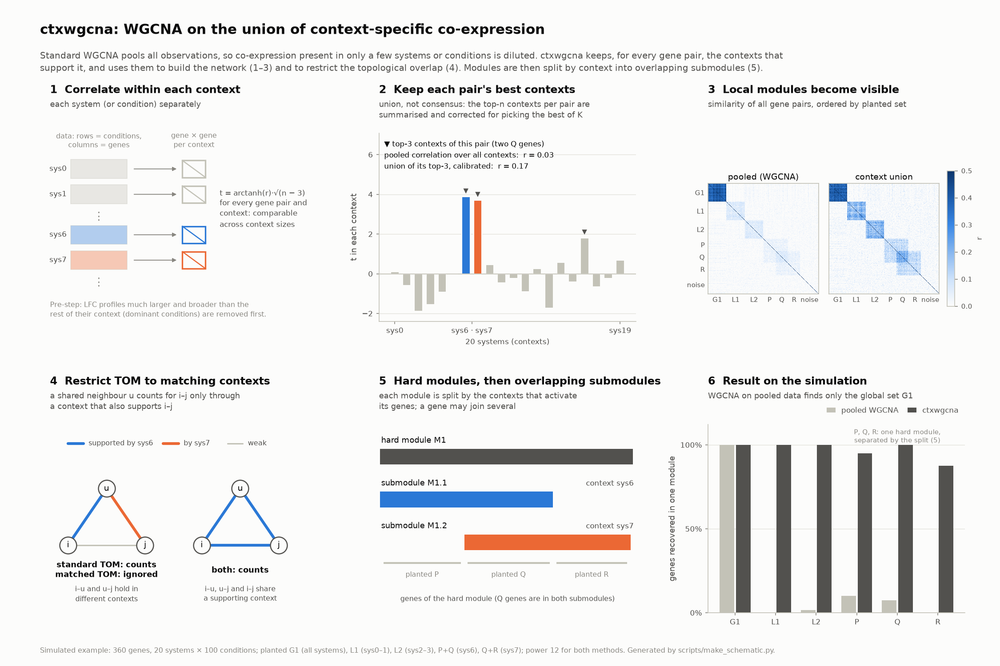

# ctxwgcna — context-aware WGCNA

WGCNA adapted for data measured across many **contexts** (e.g. systems, or conditions), designed for
fold-change (FC) profiles but applicable to any samples × genes matrix (see
[Using expression data instead of FC](#using-expression-data-instead-of-fc)). Standard WGCNA builds a network from one gene–gene correlation over all samples, so
genes that are co-regulated in only a few contexts look unrelated. `ctxwgcna` instead:

1. computes gene–gene similarity **separately in each context**,
2. keeps, for every gene pair, the **best-supporting n contexts** (a *union* over contexts, not a
   consensus), corrected for the optimism of picking the best n,
3. remembers **which contexts** support each pair,
4. builds a WGCNA network whose **TOM only counts shared neighbours linked through the same
   context**, and
5. finds hard modules, then **splits each module into context-defined submodules that may share
   genes**.

<picture>
  <source media="(prefers-color-scheme: dark)" srcset="docs/schematic-dark.png">
  
</picture>

**What the schematic shows** (data panels come from a simulation with 360 genes and 20 systems ×
100 conditions):

| Panel | Adaptation | What to look for |
|---|---|---|
| 1 | Correlate **within each context** | Each system gets its own gene–gene correlation, standardized as t = arctanh(r)·√(n − 3) so contexts of different size are comparable. Dominant conditions are removed first. |
| 2 | Keep each pair's **best n contexts** | Two genes co-regulated only in sys6 and sys7: pooled r = 0.03, but the calibrated union of their top-3 contexts gives r = 0.17. The third pick (sys16) is noise, which is why the summary is corrected for picking the best of K. |
| 3 | **Union similarity** | Sets active in two systems (L1, L2) or one (P+Q, Q+R) are faint in the pooled correlation and clear in the union. |
| 4 | **Context-restricted TOM** | A shared neighbour u counts for i–j only through a context that also supports i–j, so genes linked through different contexts don't pull each other into one module. |
| 5 | **Overlapping submodules** | P, Q and R form one hard module; the split by context gives P+Q (sys6) and Q+R (sys7), with the Q genes in both. |
| 6 | Result | Pooled WGCNA recovers only the global set G1; ctxwgcna recovers all six planted sets. |

The figure is generated by `scripts/make_schematic.py` (needs `pip install -e ".[docs]"`).

```
FC matrix (observations × genes) + obs table (system, condition, …)
   │  context_col="system"
   ▼
per-context similarity ──► Fisher z, standardized ──► top-n contexts per pair ──► summary z (calibrated)
   (pearson/spearman/bicor/cosine)                       (context ids stored)          │
                                                                                       ▼
                         submodules (overlapping) ◄── hard modules ◄── context TOM ◄── adjacency (soft power)
```

---

## 1. Installation

Requirements: Python 3.10–3.14 (the test suite passes on all five; 3.12 is a good default), macOS or Linux.

### Get the code

```bash
git clone https://github.com/zhisonghe/ctxwgcna.git
cd ctxwgcna
```

All commands below are run from this folder.

### With uv (recommended)

```bash
uv venv --python 3.12 .venv
uv pip install --python .venv/bin/python -e ".[test]"
source .venv/bin/activate
```

### With pip

```bash
python3.12 -m venv .venv
source .venv/bin/activate
pip install -e ".[test]"
```

### Check the installation

```bash
python -m pytest -q                      # 33 tests, a few seconds
python scripts/run_ctxwgcna.py --simulate --power 12 --min-module-size 20 --outdir results_demo/
```

The demo should report `simulation: ARI(modules, truth) ≈ 0.98` and one module split into two
overlapping submodules.

### Use in Jupyter / JupyterHub
Install the `[jupyter]` extra (`ipykernel`, plus `anndata` to read `.h5ad` files) and register the
venv as a kernel:

```bash
uv pip install --python .venv/bin/python -e ".[jupyter]"     # or: pip install -e ".[jupyter]"
.venv/bin/python -m ipykernel install --user --name ctxwgcna --display-name "Python (ctxwgcna)"
```

"Python (ctxwgcna)" then appears in the Jupyter / JupyterHub launcher and kernel picker (refresh
the page, or restart your server if it doesn't). Check in a notebook:

```python
import sys, ctxwgcna
print(sys.executable)    # should end in ctxwgcna/.venv/bin/python
```

- `--user` writes `~/.local/share/jupyter/kernels/ctxwgcna/kernel.json`, which points to the venv's
  Python by absolute path. On JupyterHub, the venv must therefore be created **on the machine (or
  shared file system) where your Jupyter server runs**; a venv built on a Mac does not run on a
  Linux hub.
- If you move or recreate the venv, rerun the `ipykernel install` line (it overwrites the entry).
- ctxwgcna is installed in editable mode (`-e`): code changes take effect after a kernel restart.
- Other packages your notebooks need go into the same venv, e.g.
  `uv pip install --python .venv/bin/python scanpy`.
- Remove the kernel with `jupyter kernelspec uninstall ctxwgcna`.

### Dependency notes
| Package | Why | Note |
|---|---|---|
| `numpy`, `pandas`, `scipy` | core | Tested with numpy 2.2–2.5, scipy 1.15–1.18, pandas 2.3 and 3.1. |
| `dynamicTreeCut==0.1.1` | dynamic hybrid tree cut | Pinned: verified to reproduce R `dynamicTreeCut::cutreeDynamic` exactly (with PAM off). The package is unmaintained; ctxwgcna patches its use of `scipy.stats.rankdata`, which broke with scipy 1.18 (see `modules._cutree_hybrid`). |
| `anndata` | reading `.h5ad` files (optional) | `[anndata]` extra; AnnData objects are detected without importing it. Also in `[test]`. |
| `scikit-learn`, `pytest` | tests only | installed by the `[test]` extra |
| `matplotlib` | README figure only | installed by the `[docs]` extra; not needed for the analysis |
| `ipykernel` | Jupyter kernel | `[jupyter]` extra (together with `anndata`); see "Use in Jupyter / JupyterHub" |

PyWGCNA is **not** a dependency. Its `cutreeHybrid` disagreed with R on identical input, and the
one function still needed (the scale-free fit index) is reimplemented in `ctxwgcna.network`,
matching PyWGCNA's output to 1e-13. `external/PyWGCNA/` (a source clone) and
`scripts/smoke_test.py` are kept only as a reference and need `pip install PyWGCNA` to run.

---

## 2. Preparing the input

You need a data matrix (observations × genes) and an observation table with the **same row
index**, either as two pandas tables or as one AnnData object (see [AnnData input](#anndata-input)).
The method was designed for fold-change (FC) data and the examples below use FC, but any samples ×
genes matrix works, as in standard WGCNA (see
[Using expression data instead of FC](#using-expression-data-instead-of-fc)). The argument is still
called `fc` (`--fc` in the script).

**FC matrix** `fc` — rows = observations, columns = genes.

| | GeneA | GeneB | … |
|---|---|---|---|
| `sysA\|cond001` | 0.83 | -0.12 | … |
| `sysA\|cond002` | … | | |
| `sysB\|cond001` | … | | |

One row is one FC profile (one condition in one system, vs. that system's control). If your file
has genes as rows, transpose it (`fc.T`, or `--transpose` in the script).

**Observation table** `obs` — one row per FC row, with the context annotations:

| | system | condition |
|---|---|---|
| `sysA\|cond001` | sysA | cond001 |
| `sysA\|cond002` | sysA | cond002 |

### AnnData input
An AnnData object can be passed directly wherever `fc` is expected (`ContextWGCNA`, `global_wgcna`,
`detect_dominant`, `drop_dominant`). Its observations × genes matrix is the data, and `adata.obs`
is the observation table, so `obs` can be left out.

```python
import anndata
from ctxwgcna import ContextWGCNA

adata = anndata.read_h5ad("data.h5ad")
cw = ContextWGCNA(adata, layer="log2fc", genes="highly_variable", context_col="system")
```

| Option | Meaning |
|---|---|
| `layer` | Use `adata.layers[layer]` instead of `adata.X` (e.g. a layer holding log2 FC). |
| `genes` | Gene subset: a list of gene names, or the name of a boolean `adata.var` column such as `highly_variable`. The subset is taken before the matrix is made dense. |
| `obs` | Optional; overrides `adata.obs`. |

Sparse matrices are converted to dense, so subset the genes for large data (cost grows with
genes²). `obs_names` and `var_names` must be unique (`adata.var_names_make_unique()`); `obs`
columns may be categorical. Reading `.h5ad` files needs `anndata` (`pip install -e ".[anndata]"`);
passing an AnnData object needs nothing extra. On the command line use `--h5ad data.h5ad`
(optionally `--layer` and `--var-subset`) instead of `--fc`/`--obs`.

### Recommendations
- **Values:** log2 FC. Prefer shrunken estimates (e.g. DESeq2 `lfcShrink`, apeglm/ashr) so noisy
  low-count genes don't produce extreme FCs that dominate correlations.
- **No missing values:** NaN raises an error (in `ContextWGCNA` and `detect_dominant`). Rows that
  are entirely NaN usually mark combinations that were never tested (e.g. a condition with too few
  cells in one system): drop them (`keep = fc.notna().any(axis=1); fc, obs = fc[keep], obs[keep]`).
  For partly-NaN rows, drop the affected genes, or fill with 0 only if "not measured" really means
  "no change".
- **Capped FCs:** if unstable FCs were capped (e.g. at ±10), many genes sitting at the cap dominate
  both the correlations and the dominance magnitude (a sum of squares: one gene at 10 counts as much
  as 100 genes at 1). Use shrunken FCs, or cap at a lower value (e.g. ±3–5) before the analysis.
- **Gene filtering:** memory and time grow with genes² (section 7). About 1,000–5,000 genes is
  comfortable. Filter for genes with meaningful FC variation (e.g. FC variance, or differentially
  expressed in at least one context), not for genes correlated with something.
- **Contexts:** choose **one** annotation column as the context (`system` *or* `condition`).
  Similarities are computed across the observations *within* each context, so:
  - `context_col="system"` → each system's genes are correlated across its conditions (e.g. 300).
  - `context_col="condition"` → each condition's genes are correlated across systems (e.g. 20).

  Contexts with fewer than `min_obs` observations are dropped. Correlations from very few
  observations are noise.

### Using expression data instead of FC
Nothing in the core method needs fold changes: per-context similarities, top-n selection, the
context TOM, modules and the submodule split work the same on a log-normalised or variance-stabilised
expression matrix (e.g. DESeq2 `vst`, log-CPM), rows = samples, columns = genes. Correlations are
computed within each context, so each context's own mean is removed and baseline differences
between contexts do not create co-expression.

Two parts assume FC, where 0 means "no change":

| Part | Why it assumes FC | With expression data |
|---|---|---|
| `similarity="cosine"` | uncentred: rewards genes moving away from 0 together | 0 has no meaning, so cosine mostly reflects expression level. Use `pearson`, `spearman` or `bicor`. |
| `detect_dominant` / `--detect-dominant` | a profile's size is its distance from 0 (sum of squares) | it would flag highly expressed samples. Centre each gene within its context first (`X - X.groupby(obs[context_col]).transform("mean")`), or skip this step. |

Each context still needs enough samples for a stable correlation (`min_obs`, default 10; 15–20 or
more is better). With FC from a 300-condition design this is easy; with plain expression data a
context is often only a few replicates, too few to use as a context on their own.

### Dominant conditions: detect and remove them first

Sometimes one condition (or a few) produces far larger changes than the rest, in **most** genes.
With Pearson correlation, that single condition dominates: its responders form giant blocks that
absorb and break up the real modules. Robust correlations (Spearman, bicor) would neutralise it,
but they also erase genuine programmes that respond in only a few conditions, which is exactly the
local structure this method is for. The recommended approach is therefore: **flag those FC profiles,
remove them, keep Pearson, and analyse the flagged conditions separately.**

Evidence from simulation (1,000 genes, 20 systems × 300 conditions; F1 of planted-module recovery):

| | global module | local L1 | local L2 | 5-condition programme |
|---|---|---|---|---|
| three dominant conditions kept (Pearson) | 0.83 | 0.60 | 0.26 | 0.11 |
| Spearman or bicor instead (one dominant condition) | ✓ | ✓ | ✓ | **0.0** |
| **flagged profiles removed (Pearson)** | **0.98** | **1.0** | **1.0** | **1.0** |

```python
from ctxwgcna import detect_dominant, drop_dominant

rows, summary = detect_dominant(fc, obs, context_col="system", label_col="condition")
print(summary.head(10))          # per condition: in how many systems it is dominant
fc_clean, obs_clean = drop_dominant(fc, obs, rows)
cw = ContextWGCNA(fc_clean, obs_clean, context_col="system")

# with AnnData: drop_dominant returns a filtered copy
rows, summary = detect_dominant(adata, layer="log2fc")
adata_clean = drop_dominant(adata, rows=rows)
```
or with the script: `--exclude-dominant` (`--detect-dominant` only reports).

**Rule.** Each FC profile (one condition in one system) is compared with the other profiles of the
**same system**. So a condition can be dominant in some systems only, and only those rows are removed;
systems may then have different numbers of conditions, which the method handles. A profile is
flagged only if it is **both**:

| Criterion | Parameter (default) | Meaning |
|---|---|---|
| larger | `min_fold` (5) | sum of squared FC over genes ≥ 5 × the system's median |
| unusual | `min_z` (4) | robust outlier among the system's profiles (log scale, median/MAD), so systems with naturally wide spreads don't get many flags |
| broad | `min_gene_frac` (0.10) | ≥ 10% of genes are extreme in it (\|robust z\| ≥ `extreme_z` = 5 for that gene within the system) |

Breadth is what separates a harmful profile from a real few-condition programme. In simulation, a
programme's strongest profiles reached 7× the median magnitude but moved only 6% of genes (kept),
while dominant conditions moved 22–60% of genes (flagged).

**Several dominant conditions are allowed, but they must stay few.** `max_frac` (default 0.05)
caps the flagged fraction per system at 5% of its profiles. The median/MAD reference is only valid
when dominant profiles are a small minority. If more profiles pass, the strongest 5% are
flagged, the rest are marked `candidate`, and a **warning** is printed. "Dominance" that widespread
is a continuum, not a few outliers, and removing rows is then the wrong tool: inspect the table,
raise `min_fold`, or reconsider.

Outputs (the script writes them to `dominance_rows.csv` and `dominance_summary.csv`):

| Table | Column | Meaning |
|---|---|---|
| `rows` (one per profile) | `ss` | sum of squared FC over all genes: the profile's size |
| | `fold` | `ss` / median `ss` of the context's profiles (5 = five times a typical profile) |
| | `robust_z` | how unusual `log2(fold)` is within the context, in robust SDs |
| | `n_extreme`, `frac_extreme` | number / fraction of genes whose FC here is \|robust z\| ≥ `extreme_z` away from that gene's typical FC in the context |
| | `candidate`, `dominant` | passes all three criteria; flagged after the `max_frac` cap |
| `summary` (one per condition) | `n_contexts` | contexts in which the condition has a profile (**not** where it is dominant) |
| | `n_dominant`, `frac_dominant` | contexts in which it is flagged |
| | `n_broad` | contexts in which it passes the breadth criterion (`frac_extreme` ≥ `min_gene_frac`), flagged or not |
| | `max_fold`, `median_fold` | its largest / median `fold` across contexts |
| | `max_frac_extreme`, `median_frac_extreme`, `mean_frac_extreme`, `min_frac_extreme` | the same for `frac_extreme`; a high minimum means broad in every context |

`fold` measures squared magnitude, not the number of changed genes, so it does not rank conditions
the same way as their DEG counts do: 100 genes at FC 1 add as much as one gene at FC 10.
`frac_extreme` is closer to "how many genes respond". Loosening the thresholds far below the
defaults (e.g. `extreme_z=1`, which a third of all genes pass in an ordinary profile) turns the
test into a ranking: `max_frac` then simply flags the largest profiles of every context.

**Analysing the flagged conditions separately.** One condition is a single data point per system,
so it has no correlation structure of its own. Take its responder genes (`|FC|` large, ideally
consistent across systems), then test which modules or submodules are enriched for them, or score
the condition on each module's eigengene.

**Gene selection.** If your genes were selected as "changed in any condition", a dominant condition
may have chosen most of them. Select genes on the remaining conditions instead.

---

## 3. Running it

### 3a. Command line (simplest)

```bash
python scripts/run_ctxwgcna.py \
    --fc fc.csv --obs obs.csv \
    --context-col system \
    --exclude-dominant \
    --outdir results/ \
    --global-baseline
```

From an AnnData file instead:

```bash
python scripts/run_ctxwgcna.py \
    --h5ad data.h5ad --layer log2fc --var-subset highly_variable \
    --context-col system --exclude-dominant --outdir results/
```

`python scripts/run_ctxwgcna.py -h` lists all options; they map one-to-one onto the parameters in
section 4. Files are read as CSV, or TSV if the name ends in `.tsv`/`.txt` (override with `--sep`).

Outputs in `results/`:

| File | Content |
|---|---|
| `modules.csv` | gene → hard module (`M1`, `M2`, …; `M0` = unassigned) |
| `submodules.csv` | one row per submodule: parent, supporting contexts, size, overlap |
| `memberships.csv` | long table gene → submodule (a gene can appear several times) |
| `membership_matrix.csv` | genes × submodules, 0/1 |
| `module_context_profile.csv` | modules × contexts: share of each module's connectivity supported by each context |
| `module_context_coherence.csv` | modules × contexts: mean within-module similarity in each context |
| `soft_threshold.csv` | scale-free fit and connectivity for each candidate power (not written when `--power` is given) |
| `global_modules.csv` | standard pooled WGCNA modules (with `--global-baseline`) |
| `matrices.npz` | summary r, adjacency, TOM (with `--save-matrices`) |
| `dominance_rows.csv`, `dominance_summary.csv` | dominant FC profiles (with `--detect-dominant` / `--exclude-dominant`) |
| `run_config.json` | all options, the chosen power, number of removed dominant profiles, runtime |

### 3b. Python API (for exploration)

```python
import pandas as pd
from ctxwgcna import ContextWGCNA, global_wgcna

fc  = pd.read_csv("fc.csv", index_col=0)     # observations x genes
obs = pd.read_csv("obs.csv", index_col=0)    # same index; has a 'system' column

cw = ContextWGCNA(fc, obs, context_col="system")   # defaults: pearson, top_n=3, signed, matched TOM
# or from AnnData: ContextWGCNA(adata, layer="log2fc", genes="highly_variable", context_col="system")

cw.compute_support()                 # steps 1-4
cw.pick_power()                      # scale-free table -> cw.sft, cw.power
print(cw.sft)                        # inspect! (see "Choosing the power")
cw.build_network(power=12)           # adjacency + context-restricted TOM
modules = cw.find_modules(min_module_size=30)
subs, mem = cw.split_modules()       # overlapping, context-defined submodules

# interpretation
cw.module_context_profile()          # which contexts carry each module
cw.module_context_coherence()        # direct per-context check of each module
cw.membership_matrix()               # genes x submodules (bool)
cw.support.pair_profile("GeneA", "GeneB")   # one pair's support in every context (needs stored t)
cw.support.pair("GeneA", "GeneB")           # its top-n supporting contexts (signed t, rank_stat)
cw.context_eigengenes("M3", contexts=["sysA", "sysB"])   # eigengene within supporting contexts

# baseline for comparison: standard WGCNA on pooled data
glob_modules, glob_power = global_wgcna(fc, power=12, min_module_size=30)
```

`cw.run(power=None, min_module_size=30)` runs `compute_support → pick_power → build_network →
find_modules` in one call (the power is picked unless given). Each step can be re-run alone, e.g.
`build_network(power=16)` then `find_modules()` without recomputing the support. A step called
before its prerequisites runs them first (e.g. `build_network()` on a fresh object computes the
support and picks the power). `split_modules()` needs `find_modules()` first, and
`membership_matrix()` needs `split_modules()`.

#### Lower-level functions
The steps are also available as plain functions, e.g. for custom pipelines:

| Function | Module | What it does |
|---|---|---|
| `as_frames(data, obs, layer, genes)` | `ctxwgcna.data` | DataFrame or AnnData input → (`fc`, `obs`) DataFrames |
| `make_context_blocks(fc, obs, context_col)` | `ctxwgcna.data` | validate input, split rows into `ContextBlock`s |
| `similarity_matrix(X, method)`, `fisher_z(S)` | `ctxwgcna.similarity` | one context's gene-gene similarity, Fisher z |
| `standardized_z(X, method)`, `z_scale(n)` | `ctxwgcna.similarity` | t = arctanh(s)·√(n − 3) for one context; √(n − 3) |
| `compute_support(blocks, ...)` | `ctxwgcna.support` | top-n contexts per pair and the calibrated summary (`ContextSupport`) |
| `soft_context_weights(t, selection)` | `ctxwgcna.support` | per-edge soft context weights from (K, …) per-context t |
| `adjacency_from_r`, `scale_free_table`, `pick_power`, `context_tom` | `ctxwgcna.network` | adjacency, power choice, context-restricted TOM (`DEFAULT_POWERS`: candidate powers) |
| `detect_modules(tom, genes)`, `module_indices(modules)` | `ctxwgcna.modules` | tree cut; `{module: gene positions}` (M0 excluded) |
| `module_context_profile`, `module_context_profile_soft`, `module_context_coherence`, `eigengene` | `ctxwgcna.modules` | module summaries |
| `split_module(t_ctx)`, `split_modules(modules, get_t, contexts)` | `ctxwgcna.submodules` | overlapping split of one / every module |
| `detect_dominant`, `drop_dominant` | `ctxwgcna.dominance` | dominant FC profiles |
| `simulate_fc(...)` | `ctxwgcna.simulate` | synthetic data with known modules |

The most used ones (`ContextWGCNA`, `global_wgcna`, `as_frames`, `make_context_blocks`, `compute_support`,
`similarity_matrix`, `fisher_z`, `adjacency_from_r`, `context_tom`, `scale_free_table`,
`pick_power`, `detect_dominant`, `drop_dominant`) can be imported directly from `ctxwgcna`.

---

## 4. Parameters

### Contexts — `ContextWGCNA(...)`
| Parameter | Default | Meaning / when to change |
|---|---|---|
| `fc` / `obs` | | The data: a DataFrame plus observation table, or an AnnData object (then `obs` defaults to `adata.obs`). |
| `layer` | `None` | AnnData only: use `adata.layers[layer]` instead of `adata.X`. |
| `genes` | `None` (all) | Gene subset: list of names, or (AnnData) a boolean `adata.var` column name. |
| `context_col` | `"system"` | Column of `obs` that defines contexts. |
| `contexts` | `None` (all) | List of context names to use, e.g. to exclude a system. |
| `min_obs` | `10` | Contexts with fewer observations are dropped (must be ≥ 4). Raise it for condition contexts if correlations look noisy. |

Input checks when the contexts are built: row (observation) and column (gene) labels must be unique,
`obs` must contain every row of `fc` (it is reordered to match), and `fc` must not contain NaN or
infinite values. Each raises a `ValueError` naming the problem.

### Similarity
| Parameter | Default | Meaning / when to change |
|---|---|---|
| `similarity` | `"pearson"` | `pearson`: co-variation around each context's mean. `spearman`: rank-based, robust to outliers. `bicor`: biweight midcorrelation (WGCNA's robust choice). `cosine`: **uncentred**, so it also rewards genes that move in the same direction relative to FC = 0 (e.g. both up across a whole system). With `cosine`, use `calibrate="permutation"`. |

### Context support (top-n union)
| Parameter | Default | Meaning / when to change |
|---|---|---|
| `top_n` | `3` | Number of best contexts summarized per pair. This sets the **minimum breadth of support** for an edge: `top_n=1` means "strong in any single context" and is noisiest; `2`–`3` is recommended. With K contexts, `top_n ≈ K` approaches ordinary pooled correlation. |
| `weighting` | `"n"` | Weight of each selected context in the summary: `n` = by n_obs − 3 (pooled Fisher z); `equal` = plain mean. |
| `calibrate` | `"analytic"` | Removes the optimism of picking the best n of K: `analytic` assumes independent contexts and that t = z·√(n_c−3) is standard normal under the null: exact in large samples for pearson, an approximation for spearman/bicor (use `permutation` there when the exact null matters); fast. `permutation` permutes each gene within each context `n_perm` times; required for `cosine`, and safer if contexts are strongly dependent. `none` skips it. |
| `n_perm` | `10` | Permutations for `calibrate="permutation"`. |
| `selection` | auto | `positive` (rank by signed t = z·√(n_c−3)) for signed networks; `absolute` for unsigned. Set only to override. |
| `store_context_t` / `store_max_mb` | `"auto"` / `2048` | Keep all per-context statistics (K × G² × 4 bytes) for soft context weights and module splitting. If they exceed `store_max_mb`, they are recomputed for module genes when needed (slower, same result). |

How big is the calibration? `cw.support.bias` is the amount subtracted (Fisher z). For 20
contexts × 300 observations with `top_n=3` it is about 0.085 (r ≈ 0.085): small. For 300
contexts × 20 observations it is large (z ≈ 0.63, r ≈ 0.56). There calibration is essential.

### Network
| Parameter | Default | Meaning / when to change |
|---|---|---|
| `network_type` | `"signed"` | `signed`: a = ((1 + r)/2)^β; negatively correlated genes are disconnected. `signed hybrid`: a = r^β for r > 0, else 0. `unsigned`: a = \|r\|^β; positively and negatively correlated genes can share a module. |
| `power` (β) | scale-free pick | See "Choosing the power". |
| `tom_mode` | `"matched"` | `matched`: a shared neighbour u counts for (i, j) only if i–u, u–j **and** i–j share a supporting context. `shared`: i–u and u–j must share a context. `standard`: ordinary WGCNA TOM (context-blind). |
| `support_min_t` | `None` | Optionally count a top-n context as "supporting" (in the TOM and in `module_context_profile(soft=False)`) only if its t ≥ this value. |

#### Choosing the power
`pick_power(powers=None, r2_cut=0.85, mean_cut=100)` returns the lowest power whose scale-free fit
(signed R²) is ≥ `r2_cut` with mean connectivity ≤ `mean_cut`. Treat it as a starting point:
- A **signed** network maps r = 0 to 0.5^β, so it needs higher powers than unsigned (WGCNA's usual
  advice: about 12–20 for signed).
- In the simulations the automatic pick (9) gave clearly worse modules than 12. Inspect `cw.sft`
  and compare modules at 2–3 powers (e.g. 8, 12, 16). Trust structure that is stable across them.

### Hard modules — `find_modules(...)`
| Parameter | Default | Meaning / when to change |
|---|---|---|
| `min_module_size` | `30` | Smallest module. Also the default minimum submodule size. With about 1,000 genes, 20–30 is reasonable. |
| `deep_split` | `2` | 0–4. Higher values split the dendrogram more finely (more, smaller modules). |
| `**cutree_kwargs` | | Passed to `dynamicTreeCut.cutreeHybrid` (e.g. `cutHeight`, `maxCoreScatter`). `pamStage` is forced off by default (the port's PAM stage is broken). |

### Overlapping submodules — `split_modules(...)`
For each hard module and each context, a gene is **active** if it has ≥ `min_partners`
significantly correlated partners inside the module in that context (single-context
t ≥ `t_thr`). Contexts that activate similar gene sets are grouped. Each group becomes a
submodule of the genes active in at least half of its contexts. A gene active in several groups
belongs to several submodules.

| Parameter | Default | Meaning / when to change |
|---|---|---|
| `t_thr` | `3.0` | Edge significance within one context, as t = arctanh(r)·√(n − 3). The same `t_thr` means a different r depending on n (table below). Raise it for stricter, smaller submodules. |
| `min_size` | `min_module_size` | Smallest submodule; also how many active genes a context needs to count for the module. |
| `min_partners` | ⌈min_size / 2⌉ | Significant partners a gene needs inside the module to be active in a context. |
| `jaccard_cut` | `0.5` | Contexts whose active gene sets overlap at least this much (Jaccard, average linkage) form one group. **Lower = fewer, broader submodules**; higher = more context-specific splits. |
| `min_context_frac` | `0.5` | A gene joins a submodule if active in at least this fraction of the group's contexts. |
| `dedup_jaccard` | `0.8` | Submodules of one module whose gene sets overlap at least this much are merged. |

| n observations per context | r at t = 3 |
|---|---|
| 300 (system contexts) | 0.17 |
| 100 | 0.30 |
| 20 (condition contexts) | 0.62 |

Columns of `submodules`: `parent`, `contexts` (comma-separated), `n_contexts`, `n_genes`,
`n_overlap` (genes also in another submodule of the same parent), `parent_size`,
`parent_unplaced` (parent genes in no submodule). A module that doesn't need splitting
yields one submodule `M<k>.1`; `M<k>.0` means no context activated enough genes.

Columns of `memberships`: `gene`, `submodule`, `parent`, `frac_contexts` (share of the
submodule's contexts in which the gene is active), `mean_t` (mean single-context z of the gene with
the other submodule members, over the submodule's contexts; a membership strength).

### Performance
| Parameter | Default | Meaning |
|---|---|---|
| `chunk_mb` | `128` | Memory per chunk while streaming over contexts. |
| `seed` | `0` | For permutation / Monte-Carlo calibration. |

---

## 5. Interpreting the results

- **`module_context_profile()`** (rows sum to 1): how much of each module's internal connectivity
  each context supports, from soft per-edge context weights. Compare with the uniform value 1/K:
  a flat row is a global module; a row peaked on a few contexts is a local module.
  `soft=False` gives the older top-n-indicator version.
- **`module_context_coherence()`**: mean within-module similarity in every context, computed
  directly from the data (independent of the top-n step). Use it to confirm a profile, e.g. high
  in the module's supporting systems and near 0 elsewhere.
- **Submodules**: `contexts` says where each submodule holds. Genes listed under two submodules of the same
  parent are shared between context-specific programmes (e.g. a gene co-regulated with set A in
  system 6 and with set B in system 7).
- **Pairs**: `cw.support.pair_profile(a, b)` shows a pair's similarity and weight in every context, and
  whether that context was in its top-n. `cw.support.pair(a, b)` lists only the top-n contexts, with
  the signed `t` and `rank_stat` (what they were ranked by: t, or |t| for unsigned networks).
- **Eigengenes**: `cw.context_eigengenes(module, contexts=[...])` returns the module eigengene
  separately within each context (over that context's observations). Use the supporting contexts:
  a pooled eigengene dilutes local modules.

---

## 6. Recommended first run on real data

1. Check for dominant conditions first: run with `--detect-dominant` and read
   `dominance_summary.csv`. If a few conditions are flagged (in some or all systems), use
   `--exclude-dominant` from then on. If the cap warning appears, look at the `fold` distribution
   before removing anything.
2. Run with defaults plus `--global-baseline`. Check how many modules are found and their context
   profiles. Global modules should look similar in both runs; local modules should appear only in
   the context run.
3. Check the power: inspect `soft_threshold.csv`, then rerun at 2–3 powers and keep conclusions that
   are stable.
4. Check the calibration: rerun once with `--calibrate permutation`. `bias` should agree closely with
   `analytic` for pearson (it did in simulation: 0.0852 both).
5. Run a negative control: permute each gene within each context. This should give few or no
   modules and no submodules (simulation: all 1,000 genes unassigned).
   ```python
   import numpy as np
   rng = np.random.default_rng(0)
   fc_null = fc.copy()
   for ctx, rows in obs.groupby("system").groups.items():
       fc_null.loc[rows] = rng.permuted(fc.loc[rows].to_numpy(), axis=0)
   ContextWGCNA(fc_null, obs).run(power=12)
   ```
6. Check sensitivity: vary `top_n` (2 vs 3) and `t_thr` / `jaccard_cut` for the split.

---

## 7. Resources

Measured on simulated data (1,000 genes, 20 systems × 300 conditions, laptop):

| Step | Time |
|---|---|
| context support, `calibrate="analytic"` | ~0.7 s |
| context support, `calibrate="permutation"`, 10 permutations | ~6 s |
| context TOM + modules + split | < 1 s |

Scaling (G genes, K contexts, n top-n):
- Memory: stored per-context statistics K·G²·4 bytes (1,000 genes × 20 contexts: 80 MB; × 300
  contexts: 1.2 GB, stored by default since `store_max_mb=2048`; on a small machine pass
  `store_max_mb=1024` so they are recomputed for module genes instead), plus about 10 G×G float64
  matrices (1,000 genes: ~80 MB; 5,000 genes: ~2 GB). Analytic calibration is simulated in chunks
  (~16 MB per 100 contexts).
- Time: TOM needs K matrix products of size G (fine up to several thousand genes); permutation
  calibration multiplies the support step by `n_perm`.

---

## 8. Method details

For context c with n_c observations and similarity s_c(i, j):

- z_c = arctanh(s_c), standardized t_c = z_c·√(n_c − 3). This makes contexts of different
  size comparable; ranking raw z would favour small, noisy contexts.
- For each pair, select the n contexts with the largest t_c (|t_c| for unsigned). The summary is
  z = Σ w_c z_c / Σ w_c over the selected contexts (w_c = n_c − 3), minus the null expectation of
  the same statistic (calibration). The summary similarity is r = tanh(z).
- Adjacency: a_ij = f(r_ij)^β (see `network_type`).
- Context TOM: TOM_ij = (L_ij + a_ij) / (min(k_i, k_j) + 1 − a_ij), with
  - standard: L_ij = Σ_u a_iu a_uj
  - shared: L_ij = Σ_u a_iu a_uj |C_iu ∩ C_uj| / n
  - matched: L_ij = Σ_u a_iu a_uj |C_ij ∩ C_iu ∩ C_uj| / n

  where C_xy is the set of top-n contexts of pair (x, y). It is computed as Σ_k (A∘I_k)(A∘I_k)
  (∘ I_k for matched). The result stays in [0, 1] and never exceeds the standard TOM.
- Modules: average-linkage clustering of 1 − TOM, then dynamic hybrid tree cut.
- Soft context weight of an edge: w_ij^k = t_k⁺ / Σ_k t_k⁺ (|t_k| for unsigned networks). This is flat
  for globally co-expressed pairs and peaked for local ones.
- Submodules: see section 4.

---

## 9. Known limitations

- **Hard modules first.** A submodule can only contain genes from its parent module; genes in
  other modules or unassigned genes are not candidates for extra membership.
- **One programme per context per module.** Two different gene programmes active in the *same*
  context inside one hard module are not separated by the split.
- **Cosine + split.** Split significance assumes a zero null mean, which doesn't hold for cosine
  (a warning is printed). Raise `t_thr` or interpret with care.
- **No module merging step.** Standard WGCNA merges modules with correlated pooled eigengenes,
  which would wrongly merge or miss local modules, so it is not applied.
- **No PAM stage.** Unassigned genes are not reassigned to the nearest module.
- **Automatic power** can be suboptimal (section 4); check several powers.
- **Validation** so far is on simulated data only.

---

## 10. Project layout

```
src/ctxwgcna/
  data.py         step 1: DataFrame / AnnData input, input checks, contexts (ContextBlock)
  dominance.py    detect / drop dominant FC profiles
  similarity.py   pearson / spearman / bicor / cosine, Fisher z, standardized t per context
  support.py      steps 2-4: top-n selection, summary, calibration, soft weights, ContextSupport
  network.py      step 5a: adjacency, scale-free table and power, context-restricted TOM
  modules.py      step 5b: tree cut, module index, context profiles (hard / soft), coherence, eigengenes
  submodules.py   overlapping context-defined split of each module
  pipeline.py     ContextWGCNA class (runs the steps), global_wgcna baseline
  simulate.py     synthetic FC data with global, local and overlapping modules
scripts/run_ctxwgcna.py   command-line runner (all ContextWGCNA options + dominance check)
scripts/make_schematic.py draws docs/schematic.png and docs/schematic-dark.png (the README figure)
scripts/smoke_test.py     PyWGCNA reference run (not part of ctxwgcna; needs PyWGCNA)
tests/test_core.py        unit + end-to-end tests (python -m pytest -q)
NOTES.md                  development log: design decisions and verified findings
docs/                     README schematic (light and dark versions)
```
